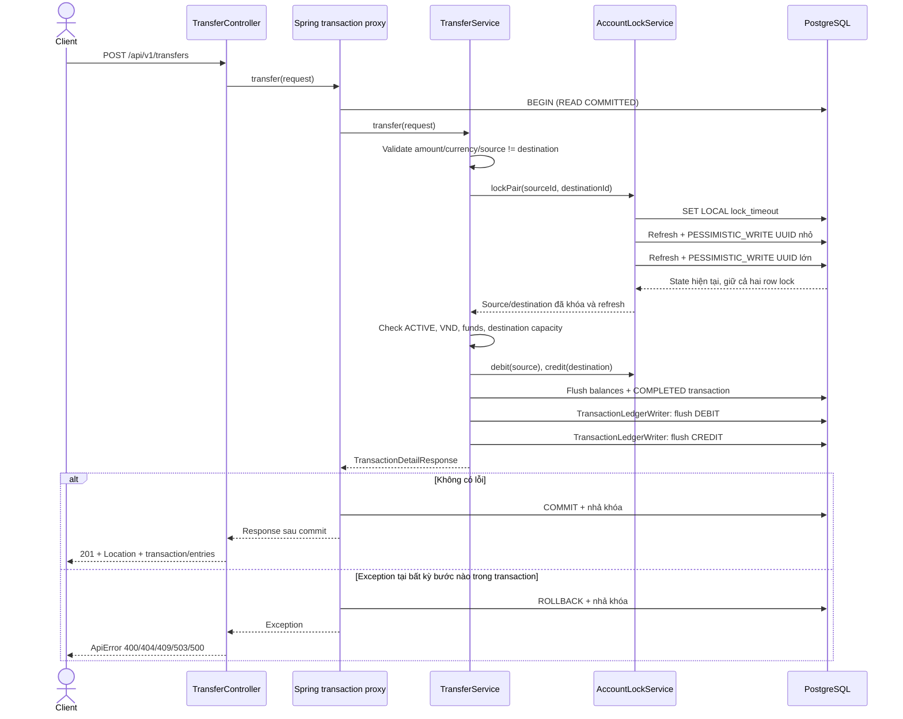

# Luồng chuyển tiền nội bộ

Mục đích: minh họa ranh giới giữ tiền/ledger nguyên tử và điểm phối hợp giữa
transfer với thay đổi trạng thái account. Đây là modular monolith, một PostgreSQL.

Rollback có thể xảy ra trước khi service tạo response, khi đang flush hoặc khi
commit. Controller chỉ nhận kết quả thành công sau khi transaction proxy commit.
Diagram rút gọn nhánh lỗi để minh họa; không tạo record COMPLETED khi chuyển thất bại.

AccountService.changeStatus cũng đi qua AccountLockService.lockOne, rồi kiểm tra
trạng thái và balance sau refresh trước khi ghi. Nếu transfer đang giữ khóa,
status update phải chờ; nếu status update commit trước, transfer đọc thấy trạng
thái mới. Không giữ row lock trong lúc gọi Kafka/network.

Không có tự retry POST, idempotency, daily limit, Kafka/outbox hoặc fraud ở phase 3.
Entry/transaction không có API cập nhật/xóa. Chi tiết contract và test fixture ở
[Transfer API](../api/transfers.md).
