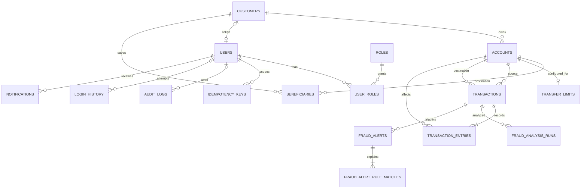

# Kế hoạch phát triển Bank Transaction & Fraud Monitoring System

Ngày lập: 27/10/2026. Kiến trúc: **Modular Monolith**, một ứng dụng Spring Boot, một database PostgreSQL, frontend React riêng. Redis và Kafka là hạ tầng hỗ trợ; không tách business module thành microservice.

Tài liệu này là kế hoạch học và triển khai. Tên class, endpoint, migration bên dưới là thiết kế đề xuất, chưa phải chức năng đã tồn tại.

**Cập nhật triển khai 27/10/2026:** đã triển khai Customer API và tích hợp Flyway ở phase 1.
Do khung 20 bảng đã được tạo thủ công trước đó, migration thực tế khởi đầu là
`V1__initial_schema.sql` chứa toàn bộ schema hiện có; các thay đổi sau dùng V2 trở đi,
không tạo lại các bảng theo tên migration đề xuất trong roadmap. Xem
[schema và quy trình tiếp nhận database](database/schema.md),
[Customer API](api/customers.md) và [báo cáo phase 1](reports/phase-1-report.vi.md).
Các phase sau vẫn là kế hoạch; việc có bảng không có nghĩa đã có nghiệp vụ.

**Cập nhật phase 2, 27/10/2026:** đã triển khai Account API gắn Customer, số dư
khởi tạo 0 VND, phân trang và đổi trạng thái có row lock. Schema accounts đã nằm
trong V1 nên không cần migration mới. Xem [Account API](api/accounts.md) và
[báo cáo phase 2](reports/phase-2-report.vi.md). Phase 3 trở đi vẫn chưa triển khai.

**Cập nhật phase 3, 27/10/2026:** đã triển khai chuyển tiền nội bộ, AccountLockService
dùng chung với đổi trạng thái, ledger DEBIT/CREDIT, truy vấn giao dịch và test
rollback/concurrency trên PostgreSQL thật. Xem [Transfer API](api/transfers.md)
và [báo cáo phase 3](reports/phase-3-report.vi.md). Phase 4 trở đi vẫn là kế hoạch.

**Cập nhật phase 4–5, 27/10/2026:** phase 4 đạt 45 test trước khi bắt đầu phase 5.
Đã bổ sung OpenAPI/Swagger UI, ErrorCode/error contract, JWT, User/Role, ownership,
API /me và quản lý user cho ADMIN. Xem [báo cáo phase 4](reports/phase-4-report.vi.md),
[báo cáo phase 5](reports/phase-5-report.vi.md) và [ma trận quyền](api/auth-security.md).
Các phase từ 6 trở đi ở thời điểm báo cáo phase 5 vẫn là kế hoạch.

**Cập nhật phase 6, 27/10/2026:** đã có hạn mức theo tài khoản nguồn/ngày Việt Nam,
Idempotency-Key PostgreSQL trong cùng transaction chuyển tiền (replay 7 ngày),
beneficiary soft delete, audit và login_history HMAC. Toàn bộ 83 test đạt
(11 unit + 72 integration trên PostgreSQL 18.6), gồm rollback sau audit/snapshot,
gửi trùng đồng thời, quota đồng thời và chờ khóa qua nửa đêm. Xem
[báo cáo phase 6](reports/phase-6-report.vi.md) và [API Phase 6](api/phase-6.md).
Các phase từ 7 trở đi ở thời điểm báo cáo phase 6 vẫn là kế hoạch.

**Cập nhật phase 7, 27/10/2026:** đã có Customer Portal React tiếng Việt:
login, tổng quan, tài khoản/chi tiết, chuyển tiền/xác nhận/kết quả, lịch sử có bộ lọc
và phân trang, beneficiary CRUD và hồ sơ. Token giữ trong memory; pending transfer
khôi phục đúng user/key/payload sau reload. Bổ sung query người nhận tối thiểu,
không mở balance/identity đối tác. Đạt 87 test backend, 47 frontend và 9 browser;
build production thành công. Có demo PostgreSQL tách biệt, không seed banking_db.
Xem [báo cáo và cách dùng Phase 7](reports/phase-7-report.vi.md).
Phase 8 trở đi ở thời điểm báo cáo Phase 7 vẫn là kế hoạch.

**Cập nhật phase 8, 27/10/2026:** đã triển khai Redis cho login attempts,
rate-limit login/transfer bằng Lua + TTL, cache DTO hồ sơ /me với invalidation
sau commit và counter transfer best effort sau commit. Redis guard lỗi trả 503;
cache lỗi fallback DB. PostgreSQL tiếp tục quyết định tiền, quota và idempotency.
Xem [báo cáo Phase 8](reports/phase-8-report.vi.md), [Redis runtime/policy](../infra/redis/README.md)
và [API Phase 8](api/phase-8.md). Phase 9 trở đi ở thời điểm báo cáo Phase 8 vẫn là kế hoạch.

**Cập nhật phase 9, 28/10/2026:** đã xây rule hậu kiểm, score/evidence có snapshot,
trigger sau commit và recovery, phân công/kết luận có optimistic version và audit,
UI rủi ro/tra cứu nội bộ. V1 đã có bảng fraud; migration thực tế V2 bổ sung snapshot
analysis và actor bền vững của transaction, không tạo lại bảng hoặc seed database
cá nhân. Xem [báo cáo Phase 9](reports/phase-9-report.vi.md) và [API](api/phase-9.md).
Phase 10 trở đi ở thời điểm báo cáo Phase 9 vẫn là kế hoạch.

**Cập nhật phase 10, 28/10/2026:** đã có Kafka completed/failed/fraud events,
receipt + consumer effect cùng PostgreSQL transaction, ack sau commit,
bounded retry/DLT và hộp thông báo riêng trên API/UI. Migration thực tế V3 mở
rộng các bảng có sẵn, không seed banking_db. Đạt 179 backend + 61 frontend +
18 browser = 258 kiểm thử, build thành công. Giới hạn commit → publish vẫn tồn
tại; Phase 11 sẽ triển khai outbox. Xem [báo cáo Phase 10](reports/phase-10-report.vi.md),
[event contract](architecture/events.md) và [Kafka/DLT playbook](../infra/kafka/README.md).

## 1. Điểm xuất phát và phạm vi

Đã đọc cấu trúc repository và cấu hình hiện tại:

- Có `backend/`, `frontend/`, `infra/`, `docs/` và Compose dạng placeholder.
- Backend dùng package `com.minh.banking`, Java 21; `pom.xml` khai báo Spring Boot `4.1.2`, JPA, Validation, Web MVC và PostgreSQL. Khi thêm thư viện, kiểm tra tương thích với phiên bản thực tế này; không lấy nguyên dependency từ tutorial Boot 3.
- `application.yaml` đang dùng `ddl-auto: update`, biến `DB_URL`, `DB_USERNAME`, `DB_PASSWORD`, và import tùy chọn `config/application-local.properties`. File local có thể ghi đè cấu hình; `.env` ở root không tự được Spring Boot nạp.
- Theo mô tả của bạn, PostgreSQL `banking_db` đã kết nối thành công. Tài liệu này không thực hiện lại kết nối hay chỉnh sửa database.
- Frontend đã có Vite/React/TypeScript; các service API hiện là placeholder. Những thư mục module có sẵn chưa có nghĩa là nghiệp vụ đã được triển khai.

Giới hạn nghiệp vụ ban đầu: chuyển tiền nội bộ tức thời, cùng tiền tệ VND, không phí, không lãi, không thấu chi, không ngân hàng ngoài, không đối soát liên ngân hàng. Dùng dữ liệu giả lập cho khách hàng và giao dịch.

### Những quyết định cần giữ xuyên suốt

1. **Tiền:** Java `BigDecimal`, PostgreSQL `NUMERIC(19,2)`; VND chỉ nhận phần thập phân bằng 0. Kiểm tra độ lớn và scale, không tự làm tròn request. API gửi tiền dạng chuỗi thập phân để frontend không mất độ chính xác.
2. **Thời gian:** lưu `TIMESTAMPTZ`/`Instant`; ngày tính hạn mức theo `Asia/Ho_Chi_Minh`. Tính khoảng ngày `[đầu ngày, đầu ngày tiếp theo)` rồi đổi sang UTC khi query.
3. **Tài khoản:** số tài khoản là chuỗi unique, khác UUID nội bộ. Không có API sửa balance trực tiếp. Đóng tài khoản theo trạng thái, không xóa lịch sử.
4. **Giao dịch:** mỗi transfer thành công có một DEBIT và một CREDIT cùng amount/currency. Tổng debit bằng tổng credit, tổng tiền không đổi trong tập tài khoản mô phỏng. Đây là ledger đơn giản cho portfolio, không tuyên bố là sổ cái kế toán ngân hàng hoàn chỉnh.
5. **Tính đúng:** kiểm tra số dư, trạng thái và hạn mức quyết định phải thực hiện lại **sau khi khóa**, trong cùng database transaction. Kiểm tra trước khóa chỉ giúp trả lỗi sớm.
6. **Kiểm thử:** viết test nhỏ theo từng phase. Phase 12 mở rộng và tự động hóa bộ test, không phải thời điểm bắt đầu kiểm thử.
7. **Migration:** Flyway quản lý DDL, Hibernate dùng `validate` sau khi chuyển đổi. Migration đã áp dụng không sửa nội dung; thay đổi bằng migration mới. Không tự bật baseline để bỏ qua schema chưa được kiểm tra.
8. **Ranh giới module:** controller gọi service; module khác dùng service/API nội bộ được công bố. Không trả JPA entity ra HTTP và không cho module khác tùy tiện ghi repository. `common` chỉ chứa kiểu dùng chung ổn định.
9. **Security theo giai đoạn:** phase 1–4 chỉ chạy local để học. Từ phase 5, mọi đường đọc/ghi dữ liệu phải được kiểm tra quyền và ownership ở backend.
10. **Nguồn dữ liệu:** PostgreSQL quyết định balance, ledger, daily limit và idempotency. Redis chỉ tối ưu hoặc giữ trạng thái tạm; Kafka không nằm trong transaction ghi tiền.

Chỉ tạo các package cần dùng, không cần thêm đủ controller/service/mapper/validator cho mọi module ngay từ đầu. Mapping đơn giản có thể viết tay; không bắt buộc interface và implementation nếu chỉ có một cách triển khai.

## 2. Mốc và dependency

| Phase | Kết quả chính | Phụ thuộc trực tiếp | Ước lượng buổi học/làm |
| --- | --- | --- | --- |
| 1 | Customer + Flyway | Backend/PostgreSQL hiện có | 4–6 |
| 2 | Account gắn Customer | 1 | 3–5 |
| 3 | Transfer + ledger + locking | 2 | 6–9 |
| 4 | Contract validation/error thống nhất | 1–3 | 3–4 |
| 5 | JWT + quyền + ownership | 4 | 5–8 |
| 6 | Limit + audit + idempotency + beneficiary | 3–5 | 6–9 |
| 7 | Customer Portal dùng API thật | 5–6 | 5–8 |
| 8 | Redis có TTL và chính sách lỗi | 5–7 | 4–6 |
| 9 | Rule engine + risk investigation | 6, 8 | 6–9 |
| 10 | Kafka + consumer chống trùng | 9 | 5–8 |
| 11 | Outbox + phục hồi publish | 10 | 5–8 |
| 12 | Bộ kiểm thử hồi quy và CI | 1–11 | 5–8 |
| 13 | Full local stack bằng Compose | 8, 10–12 | 3–5 |
| 14 | Metrics + dashboard + cảnh báo | 11, 13 | 3–5 |
| 15 | Tài liệu, demo, hoàn thiện portal nội bộ | 1–14 | 4–7 |

Một buổi khoảng 2–3 giờ tập trung; đây là ước lượng để chia việc, không phải cam kết tiến độ. Chỉ chuyển phase khi đạt điều kiện hoàn thành. Có thể dừng ở phase 6 để có backend chuyển tiền đáng trình bày, phase 9 để demo fraud, phase 11 để giải thích độ tin cậy event.

Thứ tự 15 phase được giữ theo yêu cầu. Ba bổ sung để tránh thiếu dependency: beneficiary ở phase 6 phục vụ rule “người thụ hưởng mới”; kiểm thử PostgreSQL thật bắt đầu ở phase 3; Docker runtime dùng cho Testcontainers/hạ tầng cục bộ trước phase 13, còn Compose toàn hệ thống mới làm ở phase 13.

## 3. Phase 1 — Nền tảng backend, Flyway, Customer

**Mục tiêu:** dựng một lát cắt hoàn chỉnh từ HTTP → service → repository → PostgreSQL, có thể tạo lại schema từ đầu.

**Cần học:** dependency injection, JPA lifecycle, DTO, REST, SQL constraint/index, migration version/checksum, transaction cơ bản và phân trang ổn định.

**Module:** `customer`, phần nhỏ của `common` và `config`.

**File/class:** trong `backend/src/main/java/com/minh/banking/`, tạo `customer/entity/Customer`, `enums/CustomerStatus`, `repository/CustomerRepository`, `service/CustomerService`, `controller/CustomerController`, `dto/request/CreateCustomerRequest`, `UpdateCustomerRequest`, `dto/response/CustomerResponse`, `mapper/CustomerMapper`. Cập nhật `pom.xml`, `application.yaml`; thêm migration ở `backend/src/main/resources/db/migration/` và `docs/database/schema.md`.

**Database/migration:** `V1__create_customers.sql`: UUID PK, customer code unique, họ tên, email chuẩn hóa unique nếu được dùng làm định danh liên hệ, phone dạng chuỗi, status, created/updated timestamp. Index theo truy vấn customer code/email; tìm tên đơn giản trước, chưa tối ưu tìm kiếm toàn văn. Flyway tự tạo schema history. Nếu schema hiện có dữ liệu: khảo sát và sao lưu trước, thử trên database dev riêng; nếu trống thì chạy migration từ đầu. Không xóa `banking_db` để làm nhanh.

**API** (mọi API nghiệp vụ dưới `/api/v1`): `POST /customers` → 201; `GET /customers/{id}`; `GET /customers?page=&size=&search=`; `PATCH /customers/{id}` cập nhật liên hệ. Có giới hạn size và sort ổn định theo `createdAt,id`. Không có hard delete.

**Test:** tạo/đọc/cập nhật; dữ liệu bắt buộc thiếu; customer không tồn tại; duplicate email/code; phân trang không lặp; migration chạy trên DB trống rồi khởi động lại không thay đổi schema. Test service với Mockito và repository với PostgreSQL dev/test riêng; chưa dùng DB cá nhân để chạy test phá dữ liệu.

**Hoàn thành:** các API hoạt động, constraint chặn dữ liệu sai, Hibernate `validate` thành công, restart không tạo DDL ngoài Flyway, giải thích được vì sao không trả entity.

**Chưa làm:** Account, JWT, Redis, Kafka, tất cả bảng tương lai. Validation tối thiểu phải có ngay; phase 4 mới chuẩn hóa toàn hệ thống.

**Dependency:** backend kết nối PostgreSQL; kiểm tra wrapper/JDK/dependency resolve trước khi thêm feature.

**Rủi ro:** Hibernate update xung đột Flyway; phiên bản Flyway thiếu module hỗ trợ PostgreSQL tương ứng; local config ghi đè env; timestamp lệch; đưa thông tin nhạy cảm vào log.

**Kiểm tra thủ công:** tạo hai customer, gửi email trùng, lấy danh sách size 1, sửa liên hệ, restart, kiểm tra dữ liệu còn và bảng `flyway_schema_history`. Lưu request/response mẫu trong `docs/api/`.

## 4. Phase 2 — Account và quan hệ Customer–Account

**Mục tiêu:** một customer sở hữu nhiều tài khoản; balance và trạng thái có quy tắc rõ ràng.

**Cần học:** FK, many-to-one, lazy loading, N+1, monetary precision, state transition, unique constraint khi tạo số tài khoản.

**Module:** `account`, tích hợp service của `customer`.

**File/class:** `Account`, `AccountStatus` (`ACTIVE`, `FROZEN`, `CLOSED`), `AccountRepository`, `AccountService`, `AccountController`, `CreateAccountRequest`, `ChangeAccountStatusRequest`, `AccountResponse`, `AccountMapper`. Chọn mapping một chiều Account → Customer; không cần collection hai chiều ở Customer nếu không dùng.

**Database/migration:** `V2__create_accounts.sql`: customer FK, account number unique, currency, balance mặc định 0, status, timestamps, CHECK balance không âm và currency VND; index `(customer_id,created_at,id)`. Không cascade xóa customer sang account. Có thể dùng `@Version` cho cập nhật metadata nếu giải thích được cơ chế, không thay thế kế hoạch khóa transfer phase 3.

**API:** `POST /customers/{customerId}/accounts`; `GET /customers/{customerId}/accounts`; `GET /accounts/{id}`; `PATCH /accounts/{id}/status`. Tài khoản mới luôn có balance 0; request không được nhận balance tùy ý.

**Test:** customer không tồn tại/inactive; tạo nhiều account cho một customer; số tài khoản trùng phải retry có giới hạn hoặc trả lỗi có kiểm soát; trạng thái không hợp lệ; đóng account có tiền bị từ chối; serialize không gây đệ quy; danh sách không tạo N+1 rõ rệt.

**Hoàn thành:** quan hệ FK đúng, số tiền không qua float/double, không có endpoint sửa balance, account CLOSED không mở lại theo quy ước ban đầu. Quyền đổi trạng thái sẽ được khóa chặt ở phase 5.

**Chưa làm:** nạp/rút tiền HTTP, transfer, lãi, phí, đa tiền tệ, số dư khả dụng/hold.

**Dependency:** phase 1; CustomerService cung cấp thao tác kiểm tra customer có thể mở tài khoản.

**Rủi ro:** `CascadeType.ALL` xóa ngoài ý muốn; generator account number chỉ dựa timestamp; định nghĩa precision không nhất quán; CLOSED khi balance khác 0.

**Kiểm tra thủ công:** tạo hai account cho customer A, một account cho B; lọc đúng từng customer; thử payload có balance; thử trạng thái không hợp lệ; xác minh constraint bằng truy vấn chỉ đọc trên DB dev.

## 5. Phase 3 — Transfer, ledger, transaction và locking

**Mục tiêu:** chuyển tiền nguyên tử, không mất/cộng tiền khi lỗi hoặc khi request đồng thời.

**Cần học:** ACID, isolation READ COMMITTED, pessimistic lock, deadlock, Spring transaction proxy/rollback, database transaction khác business transaction. Self-invocation có thể bỏ qua proxy `@Transactional`; dùng service bean riêng khi cần ranh giới transaction. Xem [Spring transaction](https://docs.spring.io/spring-framework/reference/data-access/transaction/declarative/annotations.html).

**Module:** `transaction`, mở rộng `account` bằng API nội bộ khóa và cập nhật account; controller không được ghi balance.

**File/class:** `BankTransaction` (tránh nhầm annotation Transaction), `TransactionEntry`, `EntryDirection`, `TransactionType`, `TransactionStatus`, `TransferService`, `TransferController`, `TransactionQueryService`, `TransactionController`, `TransferRequest`, `TransferResponse`, hai repository tương ứng; `AccountLockService` thuộc account. Thêm `TransferConcurrencyIT`, `TransferRollbackIT`.

**Database/migration:** `V3__create_transactions_and_entries.sql`: transactions có reference unique, source/destination FK, amount > 0, currency, type, status, timestamp, CHECK source khác destination; entries có transaction/account FK, direction, amount > 0, currency, balance_after. Với INTERNAL_TRANSFER, unique `(transaction_id,direction)` ngăn ghi debit/credit lặp; service và test đảm bảo đủ cặp, cùng amount. Index `(source_account_id,created_at,id)`, `(destination_account_id,created_at,id)`, entries `(account_id,created_at,id)`.

**Dữ liệu khởi tạo:** account ở phase 2 có balance 0. Tạo fixture chỉ trong profile dev/test: một tài khoản treasury đối ứng với số dư khởi tạo ghi rõ, dùng giao dịch `OPENING` và cặp entry để phân bổ tiền demo. Không cung cấp API nạp tiền công khai. Quy ước đối soát: opening balance của từng account cộng credit trừ debit phải bằng balance hiện tại; treasury là ngoại lệ mở sổ có chứng từ seed được ghi nhận trong tài liệu.

**Luồng cần triển khai:** validate amount/source khác destination → bắt đầu transaction tại service → khóa từng account theo UUID tăng dần bằng hai lần đọc có khóa → đọc trạng thái/balance mới → kiểm tra VND và tiền đủ → debit/credit → lưu transaction và hai entry → commit. Nếu bất kỳ bước nào lỗi, rollback toàn bộ. Mọi thao tác đổi trạng thái account cũng phải phối hợp khóa để không vượt qua kiểm tra transfer. PostgreSQL có thể gặp deadlock; thứ tự khóa nhất quán giảm nguy cơ. Xem [PostgreSQL locking](https://www.postgresql.org/docs/current/explicit-locking.html).

**API:** `POST /transfers`; `GET /transactions/{id}`; `GET /accounts/{id}/transactions?page=&size=&from=&to=`. Chỉ ghi business transaction COMPLETED khi chuyển thành công; lỗi trả HTTP phù hợp, chưa hứa lưu transaction FAILED sau rollback.

**Test:** A có 1.000.000, B 0, chuyển 200.000 cho kết quả 800.000/200.000 và đúng hai entry; thiếu tiền/âm/0/scale sai/tự chuyển/frozen/khác tiền tệ; chèn lỗi sau debit và sau entry đầu phải rollback. Hai lệnh 700.000 đồng thời từ A chỉ một thành công; A→B và B→A đồng thời không treo quá timeout; tổng balance được bảo toàn. Dùng PostgreSQL thật, worker có transaction/connection độc lập và barrier đồng bộ; Mockito không chứng minh được locking. Có thể đưa Testcontainers PostgreSQL tối thiểu vào đây, phase 12 mới mở rộng toàn bộ.

**Hoàn thành:** test cạnh tranh và rollback pass, entry không sửa/xóa qua API, không balance âm, xác minh không có cập nhật account ngoài đường ghi có khóa.

**Chưa làm:** tự retry POST từ client, idempotency, hạn mức ngày, Kafka, fraud blocking, reversal. Giao dịch đã commit muốn hoàn tiền sau này phải có giao dịch bù, không sửa ledger cũ.

**Dependency:** phase 2; PostgreSQL test và Docker runtime nếu dùng Testcontainers.

**Rủi ro:** đọc balance trước khóa rồi dùng lại; khóa theo source trước gây A↔B deadlock; catch exception làm transaction vẫn commit; kiểm thử bị bao trong một transaction duy nhất; giữ khóa trong lúc gọi network.

**Kiểm tra thủ công:** dùng hai tab HTTP client chuyển tiền, so sánh balances và entries bằng SQL; chạy hai phiên SQL để quan sát blocking có timeout trên DB test; cố ý gây lỗi trong test rồi chứng minh không có debit đơn lẻ.

## 6. Phase 4 — Validation, exception và API contract

**Mục tiêu:** lỗi nhất quán, client phân biệt được sai input, sai nghiệp vụ và lỗi hệ thống.

**Cần học:** Bean Validation, constraint ở DTO so với DB, HTTP semantics, exception translation, Problem Details hoặc envelope tùy chọn, OpenAPI.

**Module:** `common.exception`, `common.response`, `common.validation`, `config`; cập nhật Customer/Account/Transfer.

**File/class:** `GlobalExceptionHandler`, `BusinessException`, `ErrorCode`, `ApiError`, `FieldViolation`, `PageResponse`, `RequestIdFilter`, `OpenApiConfig`. Chọn lỗi chuẩn gồm `code,message,fieldErrors,requestId,timestamp,path`; thành công trả DTO và pagination thống nhất. Không bắt buộc bọc tất cả response bằng một envelope. Cập nhật `docs/api/error-codes.md` và OpenAPI contract.

**Database/migration:** không thêm bảng. Chỉ thêm migration tiếp theo nếu rà soát thấy thiếu CHECK/UNIQUE/FK; không sửa V1–V3 đã chạy.

**API:** giữ endpoint; chuẩn hóa 400 sai format/validation, 404 không thấy, 409 conflict/state/thiếu tiền, 500 lỗi bất ngờ; dự trù 401/403 và 429 ở phase sau. Viết error code cụ thể như `INSUFFICIENT_FUNDS`, `ACCOUNT_NOT_ACTIVE`, `CUSTOMER_NOT_FOUND`. Thêm tài liệu Swagger/OpenAPI bằng dependency tương thích Boot hiện có.

**Test:** JSON hỏng, UUID sai, amount sai scale, size quá lớn, khoảng ngày đảo, duplicate do DB race, lỗi không dự kiến không lộ stacktrace/SQL; controller contract test và service test xác nhận đúng mã.

**Hoàn thành:** API cũ giữ hành vi nghiệp vụ, mọi lỗi có format chung; tài liệu có request/response mẫu; lỗi server có requestId để tìm log. Không dùng HTTP 200 cho mọi lỗi.

**Chưa làm:** framework validation tự chế, abstraction chung quá lớn, JWT, đa ngôn ngữ error message.

**Dependency:** phase 1–3; validation an toàn đã có từ trước, phase này chỉ hệ thống hóa.

**Rủi ro:** catch tất cả thành 400 che lỗi server; exception DB làm transaction rollback-only rồi vẫn tiếp tục ghi; thay contract khiến frontend sau này hiểu sai.

**Kiểm tra thủ công:** gọi mỗi nhóm lỗi trên Swagger/HTTP client, đối chiếu status/code; gây lỗi kiểm soát trên test profile để kiểm tra response 500 và requestId trong log.

## 7. Phase 5 — Spring Security, JWT và RBAC

**Mục tiêu:** xác thực đúng user và giới hạn dữ liệu theo cả role lẫn ownership.

**Cần học:** password hashing, JWT ký/verify/expiry/issuer/audience, SecurityFilterChain, method security, principal, CORS, khác biệt 401/403, IDOR/BOLA.

**Module:** `auth`, `security`, `user`; liên kết user với customer.

**File/class:** `User`, `Role`, `UserRepository`, `RoleRepository`, `AuthController`, `AuthService`, `LoginRequest`, `TokenResponse`, `SecurityConfig`, `JwtConfig`, `CurrentUser`, `OwnershipService`, `UserController`, `UserService`. Ưu tiên cơ chế JWT decoder/resource server của Spring Security phù hợp dependency; không tự viết crypto/JWT parser. Dùng password encoder đã được Spring hỗ trợ.

**Database/migration:** `V4__create_users_and_roles.sql`: users có username unique, password_hash, enabled, customer_id nullable unique; roles có code unique; user_roles PK kép và FK. Seed bốn role CUSTOMER/BANK_STAFF/RISK_OFFICER/ADMIN. User demo chỉ tạo trong dev/test bằng password đọc từ cấu hình local, không commit mật khẩu/key thật. Thêm migration liên kết customer hiện có khi cần, không gán tự động sai người.

**API:** `POST /auth/login`, `GET /me`; ADMIN dùng `POST /users`, `PATCH /users/{id}/roles`, `PATCH /users/{id}/status`. CUSTOMER dùng `GET /me/accounts`, `GET /me/transactions`; API `/accounts/{id}` và `/transactions/{id}` cũng kiểm tra ownership. Không nhận userId/customerId từ body làm danh tính người chuyển.

**Ma trận quyền:** CUSTOMER đọc/chuyển tiền từ account của mình, không sửa role/status/balance; BANK_STAFF tra cứu customer/account/transaction và tạo customer/account theo phạm vi demo, không chuyển tiền thay khách hay tự đổi role; RISK_OFFICER đọc alert và dữ liệu điều tra được giới hạn, xử lý alert; ADMIN quản lý user/role/rule/config. Đổi trạng thái account là quyền riêng được ghi rõ cho STAFF/ADMIN. ADMIN không mặc nhiên được chuyển tiền từ account bất kỳ.

**Test:** login đúng/sai/disabled; password hash không lộ; token hết hạn/sai chữ ký/sai issuer-audience; thiếu token 401; sai role 403; customer A không đọc account/transaction B qua ID hay bộ lọc; staff không sửa role; body chứa source account của người khác bị từ chối. Chọn chính sách 404 cho tài nguyên ngoài ownership để giảm lộ thông tin.

**Hoàn thành:** mọi endpoint đã có policy; không có endpoint chuyển tiền cũ bỏ qua auth; Swagger hỗ trợ bearer token; frontend chưa cần để chứng minh bảo vệ API. Access token ngắn hạn; giai đoạn này đăng nhập lại khi hết hạn. Disabled/role change phải có semantics rõ: kiểm tra trạng thái/quyền hiện tại khi request để có hiệu lực ngay, JWT chủ yếu cung cấp user ID.

**Chưa làm:** đăng ký công khai, OAuth/social login, MFA/OTP thật, refresh-token rotation, token blacklist Redis, SSO ngân hàng.

**Dependency:** phase 4; thiết kế liên kết User–Customer và ma trận quyền trước khi viết rule bảo vệ.

**Rủi ro:** chỉ chặn menu frontend; để hở endpoint admin; SQL log/Swagger lộ thông tin; wildcard CORS; tin role cũ trong JWT sau khi đã thu hồi.

**Kiểm tra thủ công:** tạo hai customer và ba user nội bộ bằng dev fixture; đăng nhập từng role; dùng token A truy cập ID của B; thử token bị sửa, hết hạn và user bị khóa. Lưu ma trận kết quả vào tài liệu.

## 8. Phase 6 — Transfer limit, audit, idempotency và beneficiary

**Mục tiêu:** retry không chuyển tiền lần hai, đồng thời không vượt hạn mức, hành động quan trọng truy vết được.

**Cần học:** unique constraint dưới concurrency, canonical request hash, atomicity, idempotency scope/retention, timezone, audit so với application log.

**Module:** `limit`, `audit`, `idempotency`, `beneficiary`; cập nhật `transaction` và `auth`.

**File/class:** `TransferLimit`, `TransferLimitService`, `IdempotencyRecord`, `IdempotencyService`, `AuditLog`, `AuditService`, `LoginHistory`, `Beneficiary`, `BeneficiaryService`, `BeneficiaryController` cùng repository/DTO; `TransferPolicy`. Không dùng filter lưu key tách rời transaction chuyển tiền.

**Database/migration:** `V5__create_limits_beneficiaries_audit_idempotency.sql` tạo `transfer_limits` (scope source account, per-transfer/daily amount > 0, currency), `beneficiaries` (owner_customer_id, destination_account_id, created_at; unique cặp owner/destination), `audit_logs`, `login_history`, `idempotency_keys`. Key unique `(actor_id,operation,key)`, request_hash, transaction_id, response_status/body snapshot, created_at, expires_at. FK audit actor nullable cho login thất bại; không lưu password/token, IP/log data có chính sách che và giữ hạn chế.

**Triển khai thực tế:** năm bảng và partial unique beneficiary đã có trong V1
được tiếp nhận ở phase 1; không tạo lại V5 hoặc sửa migration cũ. Phase 6 dùng
JDBC repository/service cho các bảng này, cùng transaction manager với JPA ledger.

**Thiết kế limit:** phiên bản đầu theo **tài khoản nguồn**, không gắn nhãn là hạn mức tổng customer. Sau khóa source, lấy hạn mức và tổng amount COMPLETED trong ngày trên PostgreSQL; mọi transfer từ source đều dùng cùng khóa nên không cùng vượt quota. Admin cập nhật limit cũng khóa source trước để phối hợp. Khi muốn limit theo customer phải thêm cơ chế khóa/usage ở scope customer, không cộng cache rồi hy vọng đúng.

**Thiết kế idempotency:** bắt buộc `Idempotency-Key` cho POST transfer; cùng actor/operation/key + canonical payload trả lại kết quả gốc; cùng key khác payload → 409. Trong một transaction: claim key bằng insert có unique conflict handling an toàn → nếu đã có record kiểm tra hash và replay → nếu mới thì khóa account, check policy, ghi tiền/ledger/audit, response snapshot → commit cùng key. PostgreSQL unique constraint phân xử request đồng thời; không chỉ `find` rồi `save`. Nếu exception làm transaction aborted, rollback rồi đọc kết quả winner trong transaction mới; không tiếp tục query trên transaction hỏng. Business failure rollback key ở bản đầu, retry được đánh giá lại; transient 5xx không được ghi như kết quả thành công. Kiểm tra auth/ownership trước khi replay.

**Retention:** chọn cửa sổ demo rõ, ví dụ 7 ngày; không xóa key đang xử lý, không hứa replay vô thời hạn. Sau expiry có thể thành request mới, UI phải cảnh báo/truy vấn history thay vì tạo key mới khi kết quả chưa rõ. Nếu xử lý đang bị lock quá thời gian, trả lỗi retryable có hướng dẫn retry cùng key.

**API:** `GET /me/transfer-limits?accountId=`; `PUT /accounts/{id}/transfer-limit` cho ADMIN; CRUD `/me/beneficiaries` (xóa quan hệ không xóa lịch sử); `GET /audit-logs` cho ADMIN/STAFF có phạm vi; POST transfer bổ sung header. Audit thành công ghi cùng transaction với thay đổi; login thất bại và business failure quan trọng cần writer transaction riêng sau rollback, không dựa vào transaction vừa thất bại.

**Test:** sát/vượt per-transfer/daily; hai transfer cộng vượt ngày chỉ một được chấp nhận; thời điểm 23:59/00:00; cùng key gửi tuần tự và đồng thời tạo đúng một transaction/hai entry; cùng key khác payload; key người khác không lấy được response; rollback không giữ success record; HTTP mất response sau commit retry nhận transaction cũ; audit không chứa credential; beneficiary trùng/ngoài ownership.

**Hoàn thành:** có bằng chứng concurrency cho cả limit và idempotency trên PostgreSQL thật; limit rejection không thay balance; audit đúng actor/action/target/outcome/requestId; beneficiary đủ timestamp phục vụ phase 9.

**Chưa làm:** Redis distributed lock cho tiền, limit đa cấp phức tạp, quy trình tăng hạn mức nhiều người duyệt, audit chống sửa ở mức hạ tầng chuyên dụng.

**Dependency:** phase 3–5; principal đáng tin và lock order ổn định. Khi thêm tài nguyên khóa, ghi rõ thứ tự: idempotency claim → accounts theo ID; không đường ghi nào đảo ngược.

**Rủi ro:** check-then-act tạo trùng; hash chuỗi JSON thô bị đổi thứ tự field; quota đọc trước khóa; response replay lộ dữ liệu; log failure bị rollback theo transfer.

**Kiểm tra thủ công:** gửi cùng request/key nhiều lần, sau đó đổi amount giữ key; mở hai client cùng chuyển vượt quota; ngắt client sau commit rồi retry cùng key; đối chiếu transaction/entry/key/audit bằng truy vấn chỉ đọc.

## 9. Phase 7 — Customer Portal cơ bản

**Mục tiêu:** demo đăng nhập → xem tài khoản → chuyển tiền → xem kết quả/lịch sử bằng API thật.

**Cần học:** React form/state, TypeScript DTO, routing, HTTP bearer, loading/error states, phân biệt lỗi network với nghiệp vụ, định dạng tiền/ngày.

**Module:** frontend `auth`, `customer`, `account`, `transaction`, `beneficiary`; backend chỉ bổ sung query tối thiểu còn thiếu, giữ policy phase 5.

**File/class:** HTTP client ở `src/shared/api/httpClient.ts`; các API, provider và trang nằm trong `src/features/<nghiệp-vụ>/`. Router và route guard ở `src/app/routes/`, kiểu API dùng chung ở `src/shared/types/`. Xem [cấu trúc hiện tại](architecture/project-structure.vi.md) và [quy ước frontend](../frontend/README.md). Cập nhật CSS/components sẵn có thay vì scaffold lại dự án.

**Database/migration:** không thêm bảng. Nếu query cần index, chứng minh bằng query plan rồi thêm migration mới; không mở field password_hash ra DTO cho tiện UI.

**API:** sử dụng `/auth/login`, `/me`, `/me/accounts`, `/me/transactions`, `/accounts/{id}`, `/accounts/{id}/transactions`, `/transfers`, `/transactions/{id}`, `/me/beneficiaries`, `/me/transfer-limits`. Không sửa profile trong scope đầu nếu chưa có API/quy tắc cập nhật.

**Hành vi bắt buộc:** access token giữ trong memory, hết hạn đăng nhập lại; route guard chỉ hỗ trợ UX. Một lần xác nhận transfer tạo một key và giữ key/payload cho retry. Nếu network timeout thì hiển thị “chưa xác định kết quả”, truy vấn history hoặc retry cùng key; không báo thất bại chắc chắn rồi tự tạo key mới. Nếu cần phục hồi qua reload, lưu pending key/payload không kèm token trong sessionStorage, kiểm tra gắn đúng user và xóa khi logout/kết thúc. Disable submit khi đang gửi, nhưng vẫn dựa vào idempotency backend. Amount gửi dưới dạng chuỗi, format hiển thị tách khỏi payload.

**Test:** form thiếu/sai tiền; API 401/403/409/429/500; token hết hạn; trang trống/loading; lịch sử phân trang; double click; timeout sau commit rồi retry; key giữ nguyên khi retry và đổi khi người dùng tạo giao dịch mới. Dùng component test cần thiết và một luồng trình duyệt với API thật.

**Hoàn thành:** thực hiện được luồng chính trên viewport desktop/mobile; balances được fetch lại sau transfer; error code ánh xạ thông báo hữu ích; `npm.cmd run build` pass; UI không cho chọn account nguồn ngoài quyền.

**Chưa làm:** portal nội bộ đầy đủ, UI fraud, chart nâng cao, realtime WebSocket, refresh token, OTP giả làm bảo mật thật.

**Dependency:** phase 5–6; contract phase 4 ổn định và CORS cho origin local cụ thể.

**Rủi ro:** token/PII trong localStorage hoặc console; frontend Number làm sai tiền lớn; key mới cho mỗi retry; coi ẩn nút là kiểm soát quyền.

**Kiểm tra thủ công:** đăng nhập hai khách bằng hai browser profile, chuyển và xem hai bên; mở Network để kiểm tra header/key; giả lập mạng chậm/mất response và refresh trang; thử URL account của người khác.

## 10. Phase 8 — Redis: login attempts, rate limit, cache, counters

**Mục tiêu:** hiểu trạng thái tạm có TTL và tăng hiệu quả đọc mà không làm sai dữ liệu tiền.

**Cần học:** key namespace, TTL, atomic INCR/Lua, cache-aside, invalidation sau commit, cache stampede, fail-open/fail-closed và thời gian cửa sổ.

**Module:** `redis` là adapter hạ tầng; policy nghiệp vụ vẫn nằm ở `auth`, `customer`, `fraud` tương lai.

**File/class:** `RedisConfig`, `RedisKeyFactory`, `LoginAttemptService`, `RateLimitService`, `RateLimitFilter`, `CustomerCacheService`, `TransactionCounterService`, cấu hình properties; hướng dẫn chạy Redis riêng trong `infra/redis/README.md`.

**Database/migration:** không tạo bảng; `login_history` vẫn bền vững từ phase 6. Redis key đề xuất: `banking:dev:login-fail:{userHash}`, `rate:{actor}:{route}:{window}`, `customer:{id}`, `tx-count:{account}:{window}`. Không đưa PII thô vào key. Chốt TTL cho từng loại, ví dụ cache 60 giây và login 15 phút; con số là tham số demo cần test.

**API:** không có Redis endpoint công khai. Login và transfer được rate-limit; 429 có `Retry-After`; `/me` có thể cache phần hồ sơ ổn định. Không cache authorization làm quyền thu hồi chậm, không cache balance cho quyết định transfer. Invalidating cache hồ sơ sau DB commit.

**Counters:** cập nhật sau commit trong phase này là best effort, có thể mất/trùng khi crash. Chỉ dùng cho demo thống kê/sàng lọc; phase 9 query PostgreSQL để quyết định rule velocity chính xác. Khi có event/outbox, vẫn phải chống xử lý trùng hoặc có cách tái tạo từ DB.

**Chính sách lỗi:** cache đọc lỗi → về DB; login/transfer throttle lỗi → chọn fail-closed 503 có log/metric, không trả 429 giả. Dữ liệu lịch sử login không mất theo Redis restart. Document chính sách để giải thích tradeoff khả dụng và chống lạm dụng. Chỉ tin forwarded IP khi cấu hình trusted proxy.

**Test:** TTL hết hạn; tăng count/cài TTL nguyên tử khi đồng thời; request đầu không tạo key sống vô hạn; reset lockout theo policy; 429 đúng thời điểm; Redis tắt thì cache fallback và protected operation 503; update customer không trả bản cũ kéo dài; counter không làm rollback tiền.

**Hoàn thành:** mỗi key có owner/TTL/policy outage; Redis restart không mất tiền/quota/idempotency; đo được cache hit/miss cơ bản qua log/test.

**Chưa làm:** Redis Cluster/Sentinel, distributed lock thay khóa PostgreSQL, lưu ledger vào Redis, cache mọi query, counters như nguồn truth fraud.

**Dependency:** phase 5–7, một Redis local/container; Compose toàn stack chưa cần.

**Rủi ro:** INCR rồi EXPIRE không atomic; account lockout bị lợi dụng gây DoS; cache không phân scope user; eviction làm quota sai nếu dùng Redis làm nguồn quyết định.

**Kiểm tra thủ công:** login sai đến ngưỡng, quan sát TTL, đợi hết khóa; gửi burst request; tắt/bật Redis để chứng minh policy; cập nhật hồ sơ rồi đọc lại; kiểm tra transfer cũ vẫn ở PostgreSQL.

## 11. Phase 9 — Fraud rules, risk scoring và investigation

**Mục tiêu:** phát hiện giao dịch đáng ngờ bằng rule giải thích được, có alert và vòng đời điều tra.

**Cần học:** rule interface, threshold/config version, score aggregation, time window, false positive, event-time so với processing-time, state machine và optimistic concurrency cho xử lý alert.

**Module:** `fraud`; dùng dữ liệu `beneficiary`, `transaction`, `login_history`, `audit`. Fraud giai đoạn này **phát hiện sau chuyển tiền**, chưa chặn transfer đã commit.

**File/class:** `FraudRule`, `FraudAlert`, `FraudAlertRuleMatch`, `FraudRuleEvaluator`, `FraudContext`, `FraudResult`, `RiskLevel`, `HighAmountRule`, `VelocityRule`, `NewBeneficiaryRule`, `FailedLoginContextRule`, `RiskScoreService`, `FraudAnalysisService`, `FraudRecoveryJob`, `FraudAlertController`, `FraudRuleController`, request/response DTO. Frontend thêm `FraudDashboardPage.tsx`, `FraudAlertsPage.tsx`, `FraudInvestigationPage.tsx`; thêm trang staff search/detail/account/transaction mức tối thiểu để hỗ trợ điều tra.

**Database/migration:** `V6__create_fraud_rules_and_alerts.sql`: `fraud_rules` (code, version, threshold, weight, enabled, updated_by/time), `fraud_alerts` (transaction_id, analysis_version, score, level, status, assigned_to, notes, resolved_at, version), `fraud_alert_rule_matches` (alert FK, rule code/version, score contribution, observed value, threshold snapshot). Unique alert theo `(transaction_id,analysis_version)`, unique match theo alert/rule code/version; index `(status,risk_level,created_at,id)`. Thêm `fraud_analysis_runs` unique transaction/version để ghi cả kết quả không có alert, tránh recovery quét lại mãi. Bảng phụ có chủ đích, không giới hạn máy móc ở danh sách ban đầu.

**Quy tắc demo:** HIGH_AMOUNT ≥ 100 triệu: +40; VELOCITY ≥ 5 transfer/10 phút: +30; NEW_BENEFICIARY được thêm <24 giờ và amount ≥ 20 triệu: +30; nhiều login fail trong 15 phút trước transfer: +20. Cap tổng 100; LOW 0–29, MEDIUM 30–59, HIGH 60–79, CRITICAL 80–100. Lưu kết quả giải thích từng rule; alert tạo khi có rule match, kể cả LOW. Rule “score vượt ngưỡng” là chính sách tổng hợp, không cộng điểm lặp từ chính score đó. Các mức tiền chỉ phục vụ dữ liệu giả lập.

**Tính nhất quán:** velocity dựa committed transactions trong cửa sổ theo thời điểm transaction, có tie-break ID; beneficiary tạo sau transaction không được tính là đã tồn tại lúc chuyển. Định nghĩa rõ destination chưa lưu beneficiary là “người nhận chưa lưu”, có thể áp cùng policy người nhận mới và ghi reason khác. Phase 9 gọi phân tích sau commit, có recovery job quét transaction chưa có analysis_run; failure phân tích không đảo ngược tiền. Tạo record phân tích, alert và match cùng DB transaction. Phase 10 chuyển trigger sang Kafka; recovery DB vẫn là đường an toàn cho đến outbox.

**API:** RISK_OFFICER dùng `GET /fraud/summary`, `GET /fraud-alerts?status=&riskLevel=`, `GET /fraud-alerts/{id}`, `PATCH /fraud-alerts/{id}/assignment`, `PATCH /fraud-alerts/{id}/resolution`; ADMIN dùng `GET /fraud-rules`, `PATCH /fraud-rules/{id}`. Resolution chọn `CONFIRMED_FRAUD` hoặc `FALSE_POSITIVE`, bắt buộc ghi chú và audit. Không tự hoàn tiền khi đánh dấu fraud.

**Test:** threshold -1/đúng/+1; hết cửa sổ; tổng score/cap/mức; beneficiary mới/cũ/chưa lưu; rule disabled; snapshot rule cũ không bị đổi sau update; phân tích trùng chỉ một alert; hai officer cùng resolve được phát hiện conflict; CUSTOMER không xem alert; recovery xử lý sau lỗi.

**Hoàn thành:** tạo được từng loại alert bằng fixture; đọc được evidence và phiên bản rule; officer điều tra/resolve có audit; trạng thái kết quả chuyển tiền không bị lẫn với trạng thái điều tra; giao dịch không có alert vẫn được đánh dấu đã phân tích.

**Chưa làm:** ML, behavioral profiling, device fingerprint, tự phong tỏa tài khoản, synchronous fraud decision trước debit, engine DSL tổng quát. Login failures riêng vẫn ở history; rule đầu tiên chỉ dùng nó làm ngữ cảnh transfer, chưa tạo loại alert login độc lập.

**Dependency:** phase 6 cung cấp beneficiary/login history/audit; phase 8 cung cấp counters tham khảo, PostgreSQL là nguồn evidence.

**Rủi ro:** phân tích lại bằng config mới làm kết quả thay đổi; count cả transaction tương lai do job trễ; double count; score bị hiểu là xác suất fraud; hậu kiểm bị mô tả nhầm thành chặn gian lận.

**Kiểm tra thủ công:** chạy fixture theo từng rule, mở dashboard bằng risk user, kiểm tra evidence, assign/resolve, xem audit; tắt rule rồi tạo transaction mới; xác minh alert cũ vẫn giữ snapshot. Chụp màn hình cho tài liệu demo sau này.

## 12. Phase 10 — Kafka và consumer chịu được message trùng

**Mục tiêu:** tách xử lý fraud/notification khỏi request mà vẫn giữ một backend modular monolith.

**Cần học:** topic, partition key, consumer group, offset, ack, retry/backoff, dead letter, at-least-once, schema version và khác biệt producer idempotence với business deduplication.

**Module:** `kafka`, `notification`, adapter cho `transaction`/`fraud`. Tất cả listener vẫn chạy trong ứng dụng Spring Boot hiện tại.

**File/class:** `KafkaConfig`, `EventEnvelope`, `TransferCompletedEvent`, `TransferFailedEvent`, `FraudDetectedEvent`, `DomainEventPublisher`, `KafkaDomainEventPublisher`, `FraudEventListener`, `NotificationEventListener`, `ProcessedEventRepository`, `Notification`, `TransferAttemptService`; topic contract trong `docs/architecture/events.md`, hướng dẫn broker ở `infra/kafka/README.md`.

**Database/migration:** `V7__create_consumer_receipts_notifications_and_attempts.sql`: `processed_events` unique `(consumer_name,event_id)`; `notifications` unique recipient/event/type, content tối thiểu, status; `transfer_attempts` có attempt_id, actor, correlation/requestId, outcome/reason, timestamps. Attempt thất bại không giả làm transaction đã ghi tiền. Không lưu request chứa credential vào event.

**Event contract:** envelope có eventId, eventType, schemaVersion, occurredAt, correlationId, aggregateId, payload tối thiểu. Topic đề xuất `banking.transfer.completed.v1`, `banking.transfer.failed.v1`, `banking.fraud.detected.v1`; key theo source account khi muốn thứ tự transfer của một nguồn. Không hứa ordering toàn hệ thống hoặc ordering giữa các topic. Topic retry/DLT có thể phá thứ tự, rule dùng event time/evidence DB thay vì tin thứ tự nhận.

**Xử lý:** transfer commit xong mới publish completed; failure có attempt_id và record riêng sau rollback trước khi publish failed. Auth/JSON invalid không cần phát business event chứa PII. Consumer ghi receipt và hiệu ứng DB cùng transaction; ack sau commit. Duplicate cùng eventId/consumer không tạo alert/notification thứ hai. Phase 9 unique transaction/version còn bảo vệ nếu hai eventId vô tình diễn tả cùng transaction.

**API:** không có API publish event công khai. Thêm `GET /me/notifications`, `PATCH /me/notifications/{id}/read` nếu làm in-app notification. Chỉ mô phỏng notification trong DB/UI, không tự gửi email/SMS ra ngoài.

**Test:** completed không phát trước commit; failed không gây entry; duplicate event; lỗi consumer trước/sau DB commit; restart đọc lại; malformed/unsupported version sang DLT sau retry có giới hạn; event trễ vẫn phân tích đúng; failed event không chạy fraud như completed.

**Hoàn thành:** transfer → consumer fraud → alert → notification hoạt động, receipt ngăn trùng; có playbook xem/replay DLT với quyền nội bộ; lệnh tắt broker không làm ledger sai.

**Chưa làm:** Kafka Streams, Schema Registry, CDC/Debezium, microservices, event sourcing, lời hứa exactly-once giữa PostgreSQL và Kafka. Kafka có guarantees riêng, nhưng ghi hiệu ứng sang DB ngoài cần phối hợp thêm; xem [Kafka delivery semantics](https://kafka.apache.org/41/design/design/).

**Dependency:** phase 9 và broker riêng/dev container; Docker runtime có trước Compose đầy đủ.

**Rủi ro:** có khoảng trống DB commit rồi process chết trước publish; event có thể mất ở phase này. Ghi nhận giới hạn bằng test và tài liệu, dùng recovery phân tích phase 9; phase 11 là yêu cầu để hoàn thiện độ bền event. Kafka retry không sửa được dual write.

**Kiểm tra thủ công:** xem topic/group/lag bằng CLI, chuyển tiền và so sánh eventId với receipt; replay message mẫu qua công cụ dev, không API public; dừng listener rồi chạy lại; gửi message sai schema vào môi trường test và kiểm tra DLT.

## 13. Phase 11 — Transactional Outbox

**Mục tiêu:** mọi thay đổi DB đã commit có event chờ publish bền vững; process chết/broker lỗi không làm mất event.

**Cần học:** dual-write problem, polling publisher, delivery at-least-once, lease/retry, `SKIP LOCKED`, crash window và consumer idempotency.

**Module:** `outbox`, adapter Kafka; cập nhật điểm ghi event trong transfer/fraud/failure handling.

**File/class:** `OutboxEvent`, `OutboxRepository`, `OutboxWriter`, `OutboxPoller`, `OutboxDispatcher`, `OutboxRetryPolicy`, `OutboxProperties`, `OutboxCleanupJob`; `docs/architecture/outbox.md`. Domain service ghi event qua interface, không trực tiếp gọi Kafka producer.

**Database/migration:** `V8__create_outbox_events.sql`: id/eventId unique, aggregate_type/id, event_type, schema_version, payload JSONB, status (`PENDING`, `PROCESSING`, `PUBLISHED`, `FAILED`), attempts, next_attempt_at, locked_until, claim_token, created_at, published_at, last_error đã lọc. Index pending theo status/next_attempt_at/created_at; chính sách giữ published và giữ failed để điều tra.

**Luồng ghi:** cùng transaction với balance/ledger/idempotency/audit ghi `TransferCompleted` outbox; cùng transaction tạo alert ghi `FraudDetected` outbox. Với transfer thất bại, rollback tiền trước, sau đó ghi `transfer_attempts` và failure outbox trong một transaction riêng qua bean riêng. Nếu process chết trước transaction failure riêng, không thể hứa mọi request thất bại đều có event; giới hạn đó phải nói rõ. Business transaction đã commit thì completed event không được mất.

**Luồng publish:** claim batch trong transaction ngắn bằng `FOR UPDATE SKIP LOCKED`, set lease/token rồi commit → gửi Kafka ngoài transaction khóa → đợi broker ack → update PUBLISHED nếu token vẫn đúng. Crash sau ack trước update sẽ gửi lại cùng eventId; consumer phase 10 phải dedupe. Crash lúc processing thì lease hết hạn cho worker lấy lại. Cấu hình timeout/batch/lease phù hợp, không đánh dấu published khi mới gọi hàm send bất đồng bộ. Scheduler single dispatcher ban đầu; chưa hứa bảo toàn order nếu retry/multi-worker khi không có thiết kế riêng.

**API:** không thêm public endpoint. Nếu cần thao tác retry FAILED, chỉ CLI/runbook nội bộ hoặc endpoint ADMIN có audit, giữ nguyên eventId và không sửa nội dung lịch sử. Không cho customer kích hoạt publish.

**Test:** rollback transfer không có completed outbox; commit có đúng event; broker down tạo backlog rồi tự phục hồi; kill sau claim; kill sau broker ack trước mark; lease takeover không để worker cũ ghi đè; nhiều poller không claim cùng hàng; duplicate publish không duplicate effect; failure writer không tạo completed event; rollback tạo alert không có fraud event.

**Hoàn thành:** mô phỏng crash ở các ranh giới và chứng minh event committed cuối cùng được xử lý sau phục hồi; backlog có thể quan sát; không còn đường completed/fraud publish trực tiếp bỏ qua outbox.

**Chưa làm:** two-phase commit, Kafka transaction thay PostgreSQL transaction, Debezium, multi-region ordering, xóa failed event tự động cho sạch dashboard.

**Dependency:** phase 10 có envelope/eventId/consumer receipts; phase 6 có atomic transfer. Giữ recovery job phase 9 làm công cụ đối chiếu, tránh chạy hai đường tạo alert không có dedupe.

**Rủi ro:** giữ row lock trong network call; lease quá ngắn tạo publish trùng; poison event retry vô hạn; update status trước ack; cleanup xóa event chưa xử lý.

**Kiểm tra thủ công:** tắt Kafka, chuyển tiền, thấy balance/ledger đúng và outbox pending; restart backend rồi bật Kafka, thấy notification/alert xuất hiện một lần; kill tại failpoint test sau ack, kiểm tra số receipt và hiệu ứng không tăng đôi.

## 14. Phase 12 — Kiểm thử đầy đủ và CI

**Mục tiêu:** người khác chạy được bộ kiểm thử và thấy bằng chứng cho các cam kết nghiệp vụ, kể cả concurrency và phục hồi.

**Cần học:** test pyramid, test isolation, deterministic clock, Testcontainers lifecycle, Maven Surefire/Failsafe, asynchronous assertions, CI reproducibility.

**Module:** tất cả; đây là củng cố test đã viết ở các phase, không viết lại business logic chỉ để đạt coverage.

**File/class:** `PostgresIntegrationTest`, `BankingTestFixtures`, `TestClockConfig`, `CustomerServiceTest`, `TransferIntegrationTest`, `TransferConcurrencyIT`, `IdempotencyIT`, `DailyLimitIT`, `SecurityAuthorizationIT`, `FraudRulesTest`, `FraudConsumerIT`, `OutboxRecoveryIT`, `RedisPolicyIT`; `application-test.yaml`, test-only failure hooks, Maven test profiles/plugins và `.github/workflows/ci.yml`. Frontend có component tests và một vài E2E cần thiết.

**Database/migration:** không thêm business table. Testcontainers tạo PostgreSQL riêng và chạy Flyway thật từ đầu; kiểm tra upgrade trên fixture schema phiên bản trước. Fixture reset/cleanup có phạm vi rõ. Không dùng H2 để kết luận PostgreSQL row lock/index/JSONB hoạt động.

**API:** không thêm API production cho test setup hay failpoint. Tất cả endpoint hiện có được kiểm tra authentication, validation, ownership và pagination. Test-only hook không được bật trong runtime bình thường.

**Test:** tiền nguyên tử và bảo toàn tổng; DEBIT/CREDIT cân; không âm; concurrency thật nhiều connection; lock timeout/deadlock được xử lý có giới hạn; limit qua nửa đêm; idempotency timeout/replay/khác payload; token/role/ownership; fraud boundary/snapshot; Redis TTL/outage; consumer duplicate/restart/DLT; outbox rollback/crash/recovery. Dùng latch/barrier và bounded await thay vì sleep cố định; worker lỗi phải được đưa về test chính.

**Chạy kiểm tra:** thiết lập `./mvnw.cmd test` cho unit/slice không phụ thuộc DB cá nhân; `./mvnw.cmd verify` cho integration profile và Testcontainers theo cấu hình đã chốt. Kiểm tra Node/JDK đúng yêu cầu; `npm.cmd ci`, frontend test, `npm.cmd run build`. Cache dependency không thay thế chạy test. CI dùng secrets demo/test và container riêng, không dùng `DB_PASSWORD` máy cá nhân.

**Hoàn thành:** checkout mới chạy được CI; không test nào cần DB local đã seed tay; concurrency test lặp một số vòng có kiểm soát vẫn ổn; có test matrix requirement → test → invariant. Coverage dùng phát hiện nhánh chưa test, không lấy 100% làm mục tiêu.

**Chưa làm:** performance benchmark quy mô production, chaos platform, mutation test toàn dự án, viết test chỉ xác nhận getter/setter hay sao chép implementation.

**Dependency:** phase 1–11; Docker khả dụng trong máy/CI, image/version tương thích và có chiến lược pull/cache.

**Rủi ro:** container startup chậm bị nhầm timeout nghiệp vụ; mock quá nhiều bỏ qua commit thật; một transaction test che lỗi rollback; flaky do clock/network; quá nhiều test trùng làm CI chậm.

**Kiểm tra thủ công:** chạy verify từ terminal mới; cố ý tạo một lỗi transfer trong nhánh thử để thấy test invariant bắt được rồi hoàn nguyên; kiểm tra test report và CI trên checkout sạch. Ghi môi trường và kết quả, không ghi “đã pass” khi chưa chạy.

## 15. Phase 13 — Docker Compose toàn hệ thống

**Mục tiêu:** một quy trình tái tạo được PostgreSQL, Redis, Kafka, backend và frontend.

**Cần học:** Docker image/layer, multi-stage build, container networking/DNS, volume, healthcheck, environment substitution, service readiness và startup retry.

**Module:** `infra`, build config backend/frontend; giữ một backend deployment.

**File/class:** `backend/Dockerfile`, `frontend/Dockerfile`, `frontend/nginx.conf` hoặc static server tương đương, `.dockerignore` phù hợp build context, hoàn thiện `docker-compose.yml`, `.env.example`, README cho `infra/postgres`, `redis`, `kafka`; helper script nếu thật sự cần.

**Database/migration:** không có migration nghiệp vụ mới; backend chạy Flyway khi startup, volume PostgreSQL lưu dữ liệu. Sử dụng database container riêng cho demo, không tự attach/ghi đè PostgreSQL `banking_db` đang chạy trên máy. Port có thể đổi để tránh 5432/8080 xung đột.

**API:** không thêm business endpoint; health/readiness nội bộ để Compose kiểm tra. Frontend dùng relative `/api` qua reverse proxy; browser không thể gọi hostname `backend` trong network Compose. Backend gọi `postgres`, `redis`, `kafka` bằng service DNS. Kafka advertised listener phải hỗ trợ đúng đường container/host sử dụng.

**Test:** `docker compose config` hợp lệ, build sạch, migrate mới, restart giữ dữ liệu, host/container cùng kết nối broker theo thiết kế, backend chờ dependency bằng retry thay vì chỉ `depends_on`, frontend deep link refresh không 404, smoke transfer/fraud/outbox qua stack thật.

**Hoàn thành:** hướng dẫn clone → cấu hình → up → login/demo chạy được; pin image version cụ thể đã kiểm chứng; không secret trong image/build args/log; backend dùng user runtime hạn chế phù hợp; named volumes và lệnh dừng được giải thích.

**Chưa làm:** Kubernetes, cloud deployment, autoscaling, production Kafka cluster, TLS infrastructure đầy đủ.

**Dependency:** phase 8, 10–12; quy trình native trước đó vẫn được ghi lại để học/debug từng thành phần.

**Rủi ro:** `localhost` trong container trỏ sai; Vite env được bake lúc build gây sai URL; Kafka advertised listener sai; heap container quá lớn; dùng `down -v` vô tình xóa dữ liệu. Đánh dấu rõ lệnh xóa volume chỉ dành môi trường demo có thể bỏ.

**Kiểm tra thủ công:** chạy stack, chuyển tiền, dừng bằng `docker compose down` không xóa volume rồi up lại; xác nhận ledger còn, Kafka/outbox phục hồi. Kiểm tra log từng service không in credential.

## 16. Phase 14 — Prometheus, Grafana và monitoring

**Mục tiêu:** quan sát độ trễ/lỗi/tắc nghẽn và liên hệ metric với các invariant nghiệp vụ.

**Cần học:** Micrometer, counter/gauge/timer/histogram, PromQL, scrape interval, label cardinality, percentile và alert threshold.

**Module:** `config`, instrumentation tại `transaction`, `fraud`, `outbox`, `redis`, `kafka`; hạ tầng `infra/prometheus`, `infra/grafana`.

**File/class:** dependency Actuator/Prometheus tương thích Boot hiện tại, `MetricsConfig`, `TransferMetrics`, `OutboxMetrics`, `FraudMetrics`, `ReconciliationJob`; `prometheus.yml`, alert rules, Grafana datasource/dashboard provisioning JSON/YAML; Compose profile observability và `docs/operations/runbook.md`.

**Database/migration:** chưa cần bảng mới. Reconciliation chỉ đọc: so sánh balance với opening + entries, tìm transaction thiếu entry/cặp không cân và entry không khớp currency. Nếu truy vấn nặng, bổ sung index qua migration mới sau đo đạc. Không tự sửa tiền khi phát hiện sai.

**API:** expose health/readiness và `/actuator/prometheus` qua management network/port giới hạn; không public toàn bộ actuator/env/configprops. Không đưa metric thành endpoint customer đọc dữ liệu người khác.

**Metrics đề xuất:** số transfer theo outcome/reason hữu hạn, latency p50/p95/p99, lock timeout, idempotency replay/conflict, limit rejection, HTTP error rate, DB pool active/pending, Redis error/cache hit, consumer lag, retry/DLT count, outbox pending/oldest age/failed, fraud alert theo level/status, reconciliation mismatch. Tăng completed counter sau commit; latency endpoint và business success không được lẫn nhau. Không dùng userId/accountId/transactionId/requestId làm label; requestId chỉ ở log.

**Test:** scrape được metric, counter không tăng completed khi rollback, histogram có dữ liệu, rule alert bật đúng khi cố ý làm Kafka down/backlog, không bị duplicate instrumentation; verify management endpoint bị chặn ngoài phạm vi. Reconciliation fixture sai bị phát hiện.

**Hoàn thành:** dashboard có traffic/error/latency/dependencies/business health; ít nhất ba cảnh báo demo có runbook: backlog quá lâu, HTTP 5xx tăng, reconciliation mismatch. Ngưỡng demo như p95 hoặc backlog age ghi rõ là giả định, không gọi là SLA production.

**Chưa làm:** distributed tracing đa service, SIEM, SRE platform, cảnh báo thật qua email/Slack nếu chưa có yêu cầu gửi ra ngoài.

**Dependency:** phase 11, 13; đủ traffic mẫu để biểu đồ có ý nghĩa. Log có requestId từ phase 4 và event correlation từ phase 10.

**Rủi ro:** high-cardinality làm Prometheus phình; metric từ memory reset khi restart bị đọc sai; Kafka down làm readiness chặn cả thao tác chỉ cần DB dù outbox vẫn hoạt động; biểu đồ đẹp nhưng không phát hiện dữ liệu sai. Chốt readiness theo khả năng phục vụ từng đường và chính sách outage đã định.

**Kiểm tra thủ công:** tạo traffic thành công/lỗi, mở Grafana; tắt Kafka cho outbox tăng, bật lại cho giảm; tạo fixture mismatch chỉ ở DB test và thấy cảnh báo; dùng requestId/eventId truy log để giải thích một ca lỗi.

## 17. Phase 15 — Hoàn thiện sản phẩm portfolio và tài liệu phỏng vấn

**Mục tiêu:** người khác hiểu, chạy và đánh giá được dự án; bạn trình bày được quyết định cùng bằng chứng thay vì liệt kê công nghệ.

**Cần học:** architecture documentation, ERD, sequence diagram, ADR, demo storytelling, mô tả thành tích có số đo và giới hạn trung thực.

**Module:** `docs` và README; hoàn thiện UI dùng API đã có cho internal portal. Không dồn tính đúng của backend đến phase này.

**File/class:** `docs/architecture/overview.md`, `module-boundaries.md`, `transfer-sequence.md`, `docs/architecture/adr/`, `docs/database/erd.md`, `docs/api/openapi.yaml`, `docs/testing/test-matrix.md`, `docs/demo/script.md`, `docs/operations/runbook.md`; cập nhật README và ảnh demo. UI bổ sung/hoàn thiện `StaffDashboardPage`, `CustomerSearchPage`, `CustomerDetailPage`, `AccountManagementPage`, `TransactionManagementPage`, `AuditLogsPage`, `UserManagementPage`, `RoleManagementPage`, `FraudRulesPage`; trang risk đã có từ phase 9.

**Database/migration:** không tạo bảng “cho đủ tên”. Rà soát ERD đúng schema thật: 16 bảng gốc cùng các bảng phụ có lý do (`fraud_alert_rule_matches`, `fraud_analysis_runs`, `processed_events`, `notifications`, `transfer_attempts`). Chỉ tạo migration bổ sung khi có khoảng trống chức năng cụ thể; demo seed tách khỏi migration production.

**API:** đóng băng/tài liệu hóa API v1 hiện có; rà soát thiếu gì trong portal nội bộ. Nếu cần, thêm có giới hạn `GET /staff/summary` và `GET /customers/{id}/summary`, projection tối thiểu theo quyền; account/transaction search dùng query filters phân trang trên API sẵn có; quản lý role/rule/audit dùng API phase 5/6/9. Không thêm chức năng quản trị chỉ ở frontend rồi bỏ policy backend.

**Test:** chạy lại bộ phase 12 và smoke trên Compose; kiểm tra link tài liệu, OpenAPI khớp response, demo trên database seed mới, từng role có đúng menu và API; mọi claim trong README có test/report hoặc chỉ rõ là thiết kế/chưa làm. Kiểm tra repository không chứa key/password/dữ liệu khách thật; không công khai hay push tự động chỉ vì chuẩn bị GitHub.

**Hoàn thành:** README có mục tiêu, phạm vi, kiến trúc, setup native/Compose, biến cấu hình, test commands, demo users qua cách seed an toàn, API, screenshots, limitations. Có ERD và sequence cho transfer/idempotency/outbox; ít nhất các ADR quan trọng: modular monolith, lock strategy, PG idempotency, Redis failure policy, fraud hậu kiểm, outbox. Nội bộ đủ luồng tra cứu → điều tra → resolve → xem audit.

**Chưa làm:** microservices, production certification, xử lý tiền thật, thêm công nghệ chỉ để CV dài hơn. Việc publish GitHub/deploy là bước riêng theo yêu cầu của bạn.

**Dependency:** phase 1–14. Tài liệu nháp được ghi từ mỗi phase, phase 15 chỉnh lại theo implementation cuối.

**Rủi ro:** README nói quá khả năng; ERD cũ; demo chỉ chạy trên máy tác giả; để UI nội bộ quá lớn che mất mục tiêu backend. Ưu tiên màn hình bảng/form đơn giản và các luồng demo có chiều sâu.

**Kiểm tra thủ công:** nhờ một người hoặc dùng checkout mới đi theo README, ghi chỗ thiếu; chạy kịch bản 10–15 phút: login → transfer → retry cùng key → hai transfer cạnh tranh → fraud alert → officer resolve → audit → Kafka down/up → outbox recovery → metrics. Không cần trình diễn mọi công nghệ cùng một lúc.

## 18. Lược đồ quan hệ và API theo vai trò

Đây là ERD khái niệm; source/destination có thể khác nullability cho OPENING so với INTERNAL_TRANSFER, cần CHECK theo type. Outbox và processed_events liên kết bằng eventId logic, không FK tới Kafka. Snapshot rule trong match giữ bằng chứng ngay cả khi cấu hình hiện tại đổi; không suy luận bằng rule row hiện tại. ERD chi tiết khi triển khai phải phản ánh đúng cột và constraint thật.

| Role | Luồng cần demo | Ràng buộc phải chứng minh |
| --- | --- | --- |
| CUSTOMER | Profile, accounts, beneficiary, transfer, result/history | Không đọc hay debit account người khác |
| BANK_STAFF | Dashboard, customer search/detail, account/transaction lookup | Không đổi role hoặc chuyển tiền thay khách |
| RISK_OFFICER | Dashboard/alerts, investigation, assign/resolve | Chỉ update trạng thái điều tra, không sửa tiền |
| ADMIN | Users/roles, rule config, transfer limit, audit | Thay đổi cấu hình có validation/audit, không tự có quyền debit |

## 19. Checklist học và bàn giao sau mỗi phase

Mỗi phase chia thành vòng nhỏ: viết quy tắc nghiệp vụ và acceptance cases → học một chủ đề → thiết kế bảng/contract → triển khai một luồng dọc → test → kiểm tra thủ công → ghi lại điều đã học. Mỗi commit nên đủ nhỏ để giải thích và review, ví dụ schema trước, service sau, API rồi test concurrency; không cần tách theo toàn bộ lớp nếu làm mất lát cắt có thể chạy.

- [ ] Mô tả được input, output và invariant của feature.
- [ ] Giải thích được ít nhất một cách làm khác và lý do chưa chọn.
- [ ] Test success, failure và cạnh tranh nếu có ghi dữ liệu nhạy cảm.
- [ ] Migration chạy mới và chạy lại an toàn; không tự sửa migration đã áp dụng.
- [ ] Không lộ entity, secret, dữ liệu người khác; cập nhật quyền khi có endpoint mới.
- [ ] Có request mẫu, kết quả kiểm tra và hạn chế còn lại trong docs.
- [ ] Chỉ ghi “hoàn thành” khi điều kiện phase đã được kiểm chứng.

Các câu hỏi tự luyện để chuẩn bị phỏng vấn:

| Sau phase | Câu hỏi cần tự trả lời được |
| --- | --- |
| 1–2 | Flyway khác `ddl-auto:update` thế nào? Vì sao DTO và FK cần thiết? |
| 3 | Hai request cùng rút tiền sẽ chạy thế nào? Khóa khi nào, theo thứ tự nào? Rollback giữ invariant gì? |
| 4 | Validation đầu vào khác business rule và DB constraint thế nào? Client có retry được lỗi này không? |
| 5 | Role đúng đã đủ chưa? Vì sao customer A vẫn phải bị chặn khi đoán ID của B? |
| 6 | Client timeout sau commit thì sao? Unique key ngăn race ra sao? Tại sao quota không đọc từ Redis? |
| 7–8 | UI biết giao dịch thất bại hay chỉ chưa biết kết quả? Redis chết thì từng chức năng xử lý thế nào? |
| 9 | Score có ý nghĩa gì? Vì sao fraud hậu kiểm không đồng nghĩa với ngăn tiền rời tài khoản? |
| 10–11 | DB đã commit mà Kafka chưa nhận thì sao? Vì sao outbox vẫn có duplicate? Consumer dedupe ở đâu? |
| 12–14 | Test nào chứng minh khóa thật? Metric nào báo event bị kẹt? Làm sao phát hiện ledger lệch balance? |
| 15 | Nếu có thêm thời gian, ưu tiên giảm rủi ro nào? Hạn chế nào khiến dự án chưa phù hợp xử lý tiền thật? |

## 20. Tài liệu chính thống dùng để học sâu

- Spring: [Transaction proxy và `@Transactional`](https://docs.spring.io/spring-framework/reference/data-access/transaction/declarative/annotations.html) — đọc trước phase 3, đặc biệt self-invocation và transaction boundary.
- PostgreSQL: [Explicit locking và deadlocks](https://www.postgresql.org/docs/current/explicit-locking.html) — đọc trước test concurrency; đối chiếu phiên bản PostgreSQL bạn dùng khi triển khai.
- Kafka: [Design và message delivery semantics](https://kafka.apache.org/41/design/design/) — đọc phase 10–11; phân biệt guarantee trong Kafka với hiệu ứng ghi database ngoài.

Các link trên đã được đối chiếu khi lập kế hoạch. Phiên bản dependency, image và API thư viện phải được kiểm tra lại tại phase sử dụng, theo stack thực tế; kế hoạch không buộc nâng cấp dự án chỉ để dùng phiên bản mới nhất.

**Bước thực hiện tiếp theo:** Phase 11 — Transactional Outbox để khép khoảng
trống PostgreSQL commit → Kafka publish. Ghi completed/fraud/failure outbox
cùng transaction tương ứng; claim/lease, đợi broker ack rồi mark published,
kiểm thử crash/retry và giữ consumer dedupe Phase 10. PostgreSQL tiếp tục quyết
định tiền, hạn mức và idempotency; giữ bộ 258 kiểm thử làm hồi quy.
