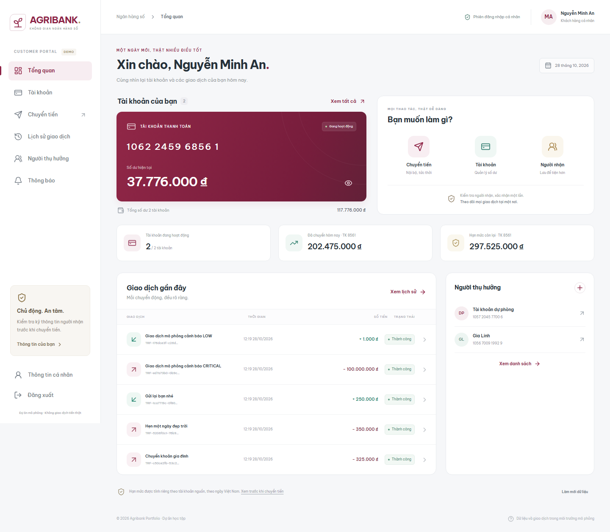

# Báo cáo Phase 7 — Customer Portal, 27/10/2026

## Mục đích và tác dụng

Đưa nghiệp vụ backend thành ứng dụng khách hàng có thể sử dụng: đăng nhập → xem
tài khoản → chọn người nhận → xác nhận chuyển tiền → xem chứng từ/lịch sử.
Đặc biệt, UI cần diễn đạt đúng kết quả chưa rõ khi mất mạng và giữ key chống trùng
đã xây ở Phase 6, thay vì vô tình tạo thêm một lần chuyển.

## Giao diện đã triển khai

Portal React/TypeScript tiếng Việt, màu đỏ rượu vang, nền sáng, sidebar desktop và
menu mobile. Font Be Vietnam Pro được đóng gói local, không cần tải Google Fonts.
Các giá trị trên màn hình đến từ API; không dùng số dư hoặc giao dịch hardcode.

- Đăng nhập: kiểm tra thiếu field, thông báo lỗi tiếng Việt, hiện/ẩn password.
- Tổng quan: số dư tài khoản, tổng số dư, tài khoản active, hạn mức nguồn, giao dịch
  gần đây và người thụ hưởng đã lưu; ẩn/hiện số dư, làm mới.
- Tài khoản: tìm/lọc trạng thái, chi tiết, sao chép số tài khoản, hạn mức và lịch sử riêng.
- Chuyển tiền: chỉ chọn nguồn của mình đang ACTIVE, kiểm tra số tài khoản nhận,
  chọn beneficiary, amount VND string, xem lại thông tin và xác nhận một lần.
- Kết quả: chứng từ, reference, số tài khoản và balanceAfter được phép xem, in chứng từ.
- Lịch sử: bộ lọc tài khoản/ngày Việt Nam và phân trang, chi tiết từng giao dịch.
- Người thụ hưởng: tạo/sửa tên gợi nhớ/xóa mềm, chọn để điền chuyển tiền.
- Hồ sơ: thông tin user/customer hiện tại, chỉ đọc; logout có xử lý pending intent.

Tài khoản nội bộ không được hiện hoặc gọi nghiệp vụ CUSTOMER; có trang hồ sơ và
thông tin phạm vi. Đây là Customer Portal, chưa phải portal quản trị hoặc UI fraud.



[Xem mobile](../screenshots/phase-7-dashboard-mobile.png) ·
[Form chuyển tiền mobile](../screenshots/phase-7-transfer-mobile.png)

## Cách mở ngay trên máy này

| Môi trường | UI | Backend | Dữ liệu |
| --- | --- | --- | --- |
| Local chính | http://127.0.0.1:5173 | 8080 | banking_db hiện tại; chưa có customer/account/tiền demo |
| Demo khách hàng | http://127.0.0.1:5174 | 8081 | Cluster PostgreSQL riêng, banking_test, dữ liệu giả lập |

Môi trường demo đã được khởi động. Đăng nhập `demo.an` để dùng portal đầy đủ,
hoặc `demo.linh` để xem phía khách hàng nhận tiền. Password ngẫu nhiên nằm trong
**backend/config/portal-demo.credentials.txt** (Git ignored). Không dùng password
admin của database cá nhân cho môi trường demo. Admin local cũ vẫn dùng được với
UI 5173 nhưng chỉ có trang hồ sơ/phạm vi, vì không mang role CUSTOMER.

Nếu đã dừng môi trường, từ backend chạy:

```powershell
.\scripts\Start-PortalDemo.ps1
```

Yêu cầu JAR backend đã build/verify, Node dependencies đã cài và PostgreSQL 18
native đã có. Script tạo cluster mới trong backend/target/portal-demo, không dùng
database cá nhân. Nó bootstraps admin demo, tạo hai customer/users và hồ sơ quỹ mô phỏng qua API, tạo bốn
account (gồm treasury và account dự phòng), rồi phân bổ reserve mô phỏng 50 triệu
bằng OPENING + đúng cặp debit/credit trong transaction có khóa UUID tăng dần.
Các giao dịch nội bộ và beneficiary mẫu tiếp theo được tạo qua API thật.

Không có API nạp tiền mới hoặc production fixture. Demo không dùng tiền thật.
Credentials demo, JWT secret, trạng thái runtime và dữ liệu cluster không được commit.
Các file ảnh chỉ chứa danh tính/dữ liệu giả lập.

Dừng demo bằng `.\scripts\Stop-PortalDemo.ps1`. Script kiểm tra đường dẫn cluster
nằm trong target/portal-demo và xác minh PID trước khi dừng; giữ lại data files,
không dừng PostgreSQL cá nhân. Khởi động demo mới tạo dataset/credentials mới.

Frontend local chính: từ frontend chạy `npm.cmd run dev` (127.0.0.1:5173), Vite
proxy đến backend 8080. Có thể cấu hình API_PROXY_TARGET bằng env hoặc .env.local.
Deployment build cần reverse proxy /api, hoặc cấu hình VITE_API_BASE_URL rõ ràng;
Vite dev proxy không nằm trong file build tĩnh. Không đặt secret/token vào VITE_*.

## Token, money và retry

Token chỉ giữ memory. Reload cần đăng nhập lại; AuthProvider/route guard đưa về
đúng trang/query đang truy cập sau login. Token hết hạn hoặc API 401 kết thúc
phiên. Backend tiếp tục là nơi kiểm tra role/ownership, không dựa vào menu UI.

Sau xác nhận, lưu owner/key/payload/time/version vào sessionStorage trước POST.
Disable submit và khóa bằng ref chống double click. Lỗi nghiệp vụ chắc chắn trả
về form; lỗi mạng/timeout/5xx giữ pending và cảnh báo “chưa xác định kết quả”.
Retry không đổi key/payload. Cùng user có thể reload/login/retry; khác user không
được đọc pending. Explicit logout xóa pending sau cảnh báo; expiry giữ để phục hồi.
Qua 7 ngày không tự gửi lại. Người dùng phải đối chiếu history trước khi đóng bản
lưu; đóng bản lưu không hủy giao dịch đã commit.

Success fetch lại danh sách balance; chứng từ lấy qua API ownership để không giữ
snapshot chứa số dư trong browser history. Response cũ không xóa intent mới của
user khác. Tiền sử dụng string/BigInt, không Number; định dạng không đổi payload.

## Backend bổ sung tối thiểu

Thêm GET /transfer-recipients theo accountNumber hoặc UUID với projection chỉ
id/accountNumber/currency/status. Không mở balance, customer ID, name/contact.
Full Account API vẫn giữ ownership. Beneficiary DTO thêm destinationAccountNumber
bằng join trong cùng query, tránh N+1 HTTP. PATCH/DELETE chỉ khóa beneficiary row.
Không thêm migration, không sửa V1. Xem [API Portal](../api/portal.md).

## Kiểm thử và kết quả

**Tổng 143 test đạt; build production đạt.**

| Lớp | Kết quả | Lệnh |
| --- | ---: | --- |
| Backend unit | 11/11 | Trong script verify bên dưới |
| Backend PostgreSQL/HTTP integration | 76/76 | backend/scripts/Test-Postgres.ps1 |
| Frontend unit/component | 47/47 | npm.cmd test |
| Browser Chromium desktop/mobile | 9/9 | npm.cmd run test:e2e |
| TypeScript + Vite production | PASS | npm.cmd run build |

Backend giữ 83 test Phase 1–6 và bổ sung 4 test cho recipient projection, validation,
role/ownership và beneficiary number. Test database là cluster PostgreSQL 18.6
riêng, không phải banking_db. Tất cả kết thúc 0 failure/error/skipped.

Frontend kiểm tra precision VND lớn nhất, input sai, date range, HTTP
401/403/409/429/500, timeout, token expiry, stale-session response, logout và
pending ownership/retention; form/double click/retry đúng key.

Browser đi qua login và backend/PostgreSQL thật để:

1. Login validation + 401 thật, dashboard, memory-only token và reload.
2. Chuyển tiền, double click tạo đúng một POST, đúng hai entries và số dư hai
   khách hàng thay đổi đúng amount; khách hàng thứ hai đăng nhập bằng context riêng.
3. Cho backend commit rồi cố ý bỏ response; reload/login/retry cùng key nhận
   Idempotency-Replayed=true, history chỉ thêm một và tiền không bị trừ lần nữa.
4. Ý định chuyển mới có key mới.
5. Beneficiary create/edit/prefill/delete bằng API thật.
6. Phân trang history, filter và empty result.
7. URL account của khách khác trả 404; response 401 có kiểm soát kiểm tra về login.
8. Viewport 390px, menu mobile, form review, không horizontal overflow; chụp ảnh.
9. Giữ GET account có kiểm soát để kiểm tra skeleton rồi empty state và nguồn rỗng.

Các lỗi HTTP giả lập/loading có kiểm soát chỉ ở test; không có failpoint UI hay
security-disabled profile trong ứng dụng. Ca mất response thực sự gọi backend
commit trước khi Playwright bỏ response. Test từ chối backend 8080/database cá nhân.

Chạy browser test sau Start-PortalDemo, trước đó cài browser một lần:

```powershell
npm.cmd exec playwright -- install chromium
npm.cmd run test:e2e
```

Playwright không ghi trace/video chứa login body hoặc JWT; screenshot chỉ dữ liệu
demo. Output trong frontend/test-results, backend/target/* đều Git ignored.

Trên Windows, dừng cả backend 8080 và demo backend 8081 trước Maven verify/package,
vì hai process đang đọc cùng JAR. Không kill PostgreSQL hoặc Java khác trên máy.

## Phạm vi tiếp theo

Phase 8 đã được triển khai tiếp: xem [báo cáo Phase 8](phase-8-report.vi.md) và
[hướng dẫn Redis](../../infra/redis/README.md). Demo mới cần Redis WSL và tạo instance
riêng ở 6381; script start/stop quản lý cùng PostgreSQL demo. Mốc 143 test phía
trên được giữ như lịch sử hoàn tất Phase 7.

Chưa có MFA, refresh
token, UI fraud, thông báo realtime, portal quản trị đầy đủ hoặc triển khai production.
Các việc này không làm thay đổi vai trò PostgreSQL trong quyết định tiền/hạn mức.
