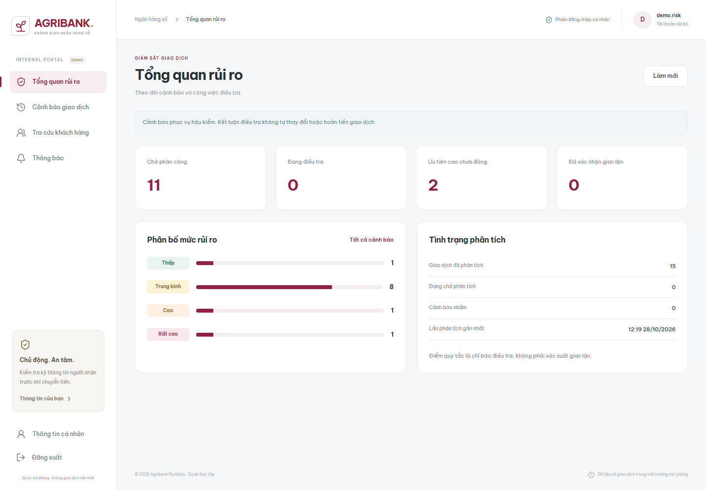

# Báo cáo Phase 9 — Fraud rules và điều tra, 28/10/2026

Đây là mốc lịch sử Phase 9. Phase 10 chuyển trigger hậu kiểm sang Kafka và bổ
sung thông báo; xem [báo cáo Phase 10](phase-10-report.vi.md) cho runtime hiện tại.

## Kết quả và mục đích

Đã hoàn thành Phase 9 theo roadmap: phát hiện giao dịch đáng ngờ bằng bốn rule
giải thích được, lưu score/evidence/version, có dashboard và vòng đời điều tra.
Đây là **hậu kiểm sau commit**. Lỗi phân tích không đảo ngược tiền; xác nhận fraud
không đổi giao dịch COMPLETED, ledger, quota hoặc tự hoàn tiền.

Trước triển khai đã đọc roadmap và báo cáo Phase 8, kiểm tra code/schema/runtime.
Mốc trước là 105 backend + 49 frontend + 9 browser. Không seed banking_db cá nhân.

## Backend và tính nhất quán

Bốn FraudRuleEvaluator: HighAmountRule, VelocityRule, NewBeneficiaryRule,
FailedLoginContextRule. RiskScoreService cộng đóng góp, cap 100; LOW 0–29,
MEDIUM 30–59, HIGH 60–79, CRITICAL 80–100. Match vẫn tạo alert khi điểm LOW/0;
không match vẫn có analysis_run để recovery không quét lại mãi.

| Rule mặc định | Điều kiện demo | Điểm |
| --- | --- | ---: |
| HIGH_AMOUNT | Amount >= 100 triệu VND | 40 |
| VELOCITY | >=5 transfer đi/10 phút, gồm giao dịch hiện tại | 30 |
| NEW_BENEFICIARY | Được lưu <24h hoặc chưa lưu tại lúc chuyển; amount >=20 triệu | 30 |
| FAILED_LOGIN_CONTEXT | >=5 login sai của actor trong 15 phút trước/lúc chuyển | 20 |

Rule/version/threshold/weight/enabled và context được snapshot ở lần phân tích
thành công đầu tiên. Match giữ observed value, reason, threshold/version riêng.
Đổi hoặc tắt rule không sửa evidence cũ. Cấu hình tại lần recovery thành công có
thể mới hơn thời điểm transfer; policy này được ghi rõ, không ngầm gọi là config
đã tồn tại ở lúc chuyển. analysisVersion=1 là engine, độc lập phiên bản từng rule.

Velocity query PostgreSQL theo (T-window,T], cùng timestamp dùng UUID <= UUID
giao dịch hiện tại, loại OPENING/future/uncommitted. Beneficiary query lịch sử
createdAt/deletedAt tại T; thêm sau T không được tính là đã lưu, đúng tuổi 24h
không còn mới. Người chưa lưu có reason riêng. Redis counter chỉ tham khảo.

Actor được lưu bền vững trong transactions.initiated_by, không mất khi key
idempotency 7 ngày hết hạn/reclaim. Login fail của user có thật nay lưu user_id,
vẫn HMAC username; user không tồn tại giữ user_id=null. Legacy history còn có thể
đối chiếu HMAC với key hiện tại. Nếu key đã xoay trước khi gắn user_id, không thể
khôi phục chính xác toàn bộ legacy context; snapshot ghi actor availability.

TransferCommitted mang transaction ID. Listener sau commit gọi analysis service
REQUIRES_NEW; run, alert, matches cùng DB transaction. Unique transaction/version
chặn phân tích trùng; lỗi rollback toàn bộ evidence. Listener catch/log lỗi để
không biến transfer đã commit thành lỗi response. FraudRecoveryJob quét tối đa
100 transaction thiếu run/lượt, mặc định 30s, khởi đầu sau 10s. Không có trigger
HTTP công khai, Kafka hoặc outbox ở phase này.

## Điều tra, quyền và UI

RISK_OFFICER xem summary, list/filter/detail/evidence và danh sách officer enabled.
Phân công đưa OPEN → IN_REVIEW, bỏ phân công về OPEN. Chỉ người được phân công
được kết luận CONFIRMED_FRAUD hoặc FALSE_POSITIVE, bắt buộc notes <=2000 ký tự.
Alert terminal không sửa lại. expectedVersion bắt buộc, SQL optimistic update
chặn hai phiên ghi đè. Cập nhật và audit nguyên tử; audit không nhân bản notes.

ADMIN sửa rule với expectedVersion, threshold typed/validated, amount string
nguyên tối đa 17 chữ số, count/window có giới hạn, weight 0–100. Không tự cắt
float thành integer. ADMIN đơn lẻ không đọc/resolve alert; có thể gán thêm role.
CUSTOMER không vào màn nội bộ hoặc đọc API fraud. Rule mặc định từ code, GET
version 1 chưa có row; PATCH đầu mới lưu override version 2 và audit.

Portal tiếng Việt bổ sung:

- Tổng quan rủi ro: hàng đợi điều tra, mức ưu tiên, phân bố risk, backlog phân tích.
- Danh sách cảnh báo: filter server theo status/risk, phân trang, liên kết detail.
- Điều tra: score/evidence từng rule, version/ngưỡng, phân công, notes/kết luận,
  audit timeline, liên kết transaction/ledger; conflict yêu cầu tải bản mới.
- Quản trị rule cho ADMIN, có tăng phiên bản và validation tiền dạng chuỗi.
- Tra cứu nội bộ khách hàng → hồ sơ → tài khoản → lịch sử → transaction/ledger,
  dành BANK_STAFF/RISK_OFFICER/ADMIN, không thêm quyền sửa cho RISK_OFFICER.
- Giữ memory-only JWT và layout desktop/mobile Phase 7; route guard/menu theo role.

[Điều tra desktop](../screenshots/phase-9-investigation-desktop.png) ·
[Điều tra mobile](../screenshots/phase-9-investigation-mobile.png)

## Migration và dữ liệu cá nhân

Giữ nguyên V1 đã áp dụng. Vì V1 đã có bảng fraud, migration thực tế tiếp theo là
**V2__fraud_analysis_snapshots.sql**: actor của transaction, snapshot analysis và
index recovery. Không tạo lại bảng theo nhãn V6 đề xuất, không chèn rule/demo.
Backfill actor dùng metadata idempotency/audit sẵn có, không ghi tiền.

Trước nâng runtime local đã backup database ở
backend/target/phase9-personal-before.dump (Git ignored). Kiểm tra chỉ đọc trước
và sau V2: **0 customers, 0 accounts, 0 transactions, 0 entries, 1 user,
0 fraud_rules, 0 analysis_runs, 0 alerts**. Không stop/reset PostgreSQL cá nhân.
Flyway local: baseline V1 đã tiếp nhận và V2 thành công; Hibernate validate đạt.

## Demo và cách dùng

Runtime đã khởi động lại:

| Môi trường | Portal | Backend | Redis | Database |
| --- | --- | --- | --- | --- |
| Local chính | 127.0.0.1:5173 | 8080 | 6379 | banking_db, không seed |
| Demo | 127.0.0.1:5174 | 8081 | 6381 | banking_test trong cluster riêng |

Đăng nhập demo.risk/demo.risk2 để điều tra, portal.admin để sửa rule, demo.staff
để tra cứu, demo.an/demo.linh để dùng portal khách hàng. Password ngẫu nhiên ở
backend/config/portal-demo.credentials.txt, không commit/in ra báo cáo.

Start-PortalDemo.ps1 hiện phân bổ reserve mô phỏng **500 triệu** bằng opening
ledger trong banking_test được guard database/user, đủ minh họa ngưỡng 100 triệu.
Tạo cảnh báo bằng transfer và login sai HTTP thật: ban đầu 1 HIGH, 8 MEDIUM,
1 CRITICAL (bốn match, tổng120 cap100), 1 LOW; 15 transfer đều có analysis_run.
Browser test có thể thêm giao dịch và xử lý alert nên trạng thái sau test thay đổi.

Demo override login-max-failures=6 để tạo 5 login sai rồi login đúng reset guard,
và login-rate-limit=120 cho setup/browser. Local chính giữ mặc định Phase 8
(5 fail, 30 login/60s). Không nới policy production hoặc thêm failpoint ứng dụng.

Tạo lại demo sau build/verify bằng backend/scripts/Start-PortalDemo.ps1; dừng
bằng Stop-PortalDemo.ps1 trước package trên Windows. Dữ liệu/credentials demo mới
được tạo mỗi lần; script không nối banking_db để seed.

## Kiểm thử

**225 test đạt, build backend/frontend đạt.**

| Lớp | Kết quả | Bổ sung Phase 9 |
| --- | ---: | ---: |
| Backend unit | 40/40 | 29 |
| PostgreSQL/Redis/HTTP integration | 113/113 | 19 |
| Tổng backend | 153/153 | 48 |
| Frontend unit/component | 57/57 | 8 |
| Browser desktop/mobile | 15/15 | 6 |

Không failure/error/skipped ở lần chạy đầy đủ. Sau chỉnh nhãn evidence tiếng Việt,
chạy lại 57 frontend test/build và browser mobile/desktop spot-check đều đạt;
không cộng lượt chạy lặp vào tổng 225.

Backend kiểm tra threshold -1/đúng/+1, cửa sổ/UUID tie, score/cap/LOW, disabled,
beneficiary cũ/mới/chưa lưu/tạo sau/xóa sau giao dịch, login thật đúng actor,
snapshot bất biến, no-match run, phân tích trùng đồng thời, lỗi sau toàn bộ writes
phải rollback rồi recovery thành công, idempotency replay không phân tích lại.
Kiểm tra phân công/resolve, hai officer cạnh tranh, stale version, invalid assignee,
notes bắt buộc, role matrix, audit failure rollback và ledger không đổi.

Browser qua PostgreSQL/Redis thật: dashboard/filter/empty, bốn evidence, assign/
resolve, đối chiếu ledger trước sau, hai officer gặp 409 thật, admin tăng version
nhưng evidence cũ giữ nguyên, customer bị chặn, staff tra cứu đến ledger, viewport
390px không overflow. Đã xem ảnh QA desktop/mobile. Test giữ đúng memory-only
session: điều hướng trong SPA hoặc login phục hồi deep link, không lưu JWT browser.

Chạy từ backend: scripts/Test-Postgres.ps1; nhóm riêng dùng -IntegrationTest
FraudWorkflowIT. Script dựng PostgreSQL/Redis riêng, tắt scheduler tự động trong
test để kiểm tra recovery có kiểm soát, trigger sau commit vẫn chạy thật.
Frontend: npm.cmd test; npm.cmd run build; npm.cmd run test:e2e sau Start-PortalDemo.

## Phạm vi tiếp theo

Phase 10 chuyển trigger phân tích sang Kafka và consumer chống trùng. Hiện hậu
kiểm chạy sau commit cùng process nên có thêm độ trễ và có khoảng crash trước
listener; recovery DB là đường bù. Chưa ML, phong tỏa tự động, fraud blocking trước
debit, outbox, CI toàn stack hoặc Compose production. Không tự chạy lại engine
version cũ theo config mới; muốn reanalysis cần policy/version engine mới rõ ràng.

Xem [API Phase 9](../api/phase-9.md), [schema](../database/schema.md),
[roadmap](../development-roadmap.vi.md) và [OpenAPI snapshot](../api/openapi.yaml).
